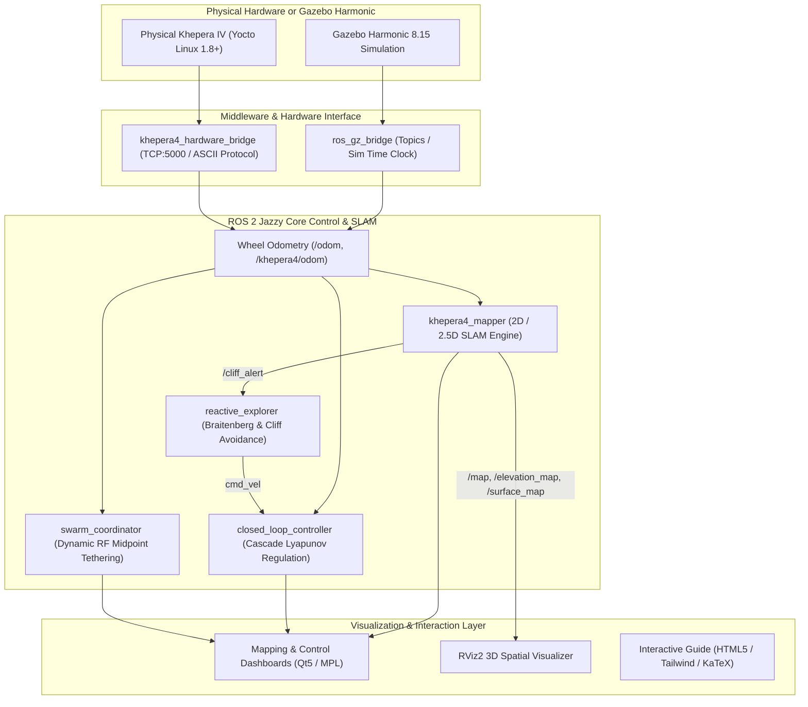
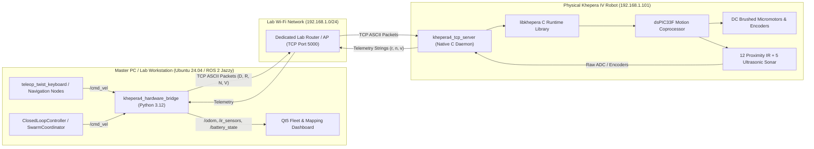

# BRT K4: Khepera IV Autonomous Robotics & Multi-Agent Swarm Stack

[](https://docs.ros.org/en/jazzy/)
[](https://gazebosim.org/)
[](https://releases.ubuntu.com/noble/)
[](https://www.python.org/)
[](#-verification--automated-tests)
[](#-academic-context--credits)
[](LICENSE)

An enterprise-grade, cyber-physical robotics research platform and educational testbed for the **K-Team Khepera IV** mobile robot. Built natively on **ROS 2 Jazzy Jalisco** and **Gazebo Harmonic (GZ Sim 8)**, this repository unifies single-robot closed-loop Lyapunov cascade control, multi-sensor 2D/2.5D SLAM, autonomous frontier exploration, and a synchronized 3-robot formation fleet with real-time TCP hardware bridges for physical robot deployment.

---

## 🚀 30-Second Quickstart

### Option 1: Universal Docker Launcher (Zero-Install Setup)
Launch instantly without configuring local ROS 2 dependencies:
```bash
./run.sh
```
* **Single Robot 2D/2.5D SLAM & Exploration:** `./run.sh --mapping`
* **3-Robot Swarm Coordination Fleet:** `./run.sh --multi`
* **Native GUI (GPU / WSLg / X11 pass-through):** `./run.sh --native`
* **Web Browser (noVNC HTML5 virtual desktop on port 6080):** `./run.sh --web`

*When using Web Browser mode, open in Chrome/Firefox:* **`http://localhost:6080`**

### Option 2: Native Host Execution (Ubuntu 24.04 LTS / WSL2)
```bash
# 1. Source ROS 2 underlay
source /opt/ros/jazzy/setup.bash

# 2. Build workspace and source overlay
colcon build --symlink-install
source install/setup.bash

# 3. Export Gazebo resource paths
export GZ_SIM_RESOURCE_PATH=$(pwd)/src/khepera4_description:$(pwd)/install/khepera4_description/share:${GZ_SIM_RESOURCE_PATH}

# 4. Launch the SLAM & Autonomous Exploration Station
ros2 launch khepera4_control mapping.launch.py auto_explore:=true rviz:=true
```

> 📖 **Full Command Reference:** For all launch permutations, arguments, headless flags, and runtime service inspection, see [`SIMULATION_COMMANDS.md`](file:///home/andy/Desktop/khepera4_ws/SIMULATION_COMMANDS.md).

---

## 🏛️ System Architecture & Computational Flow

### Software Architecture Pipeline



### Sim-to-Real Distributed Topology



---

## 🌟 Key Engineering & Research Pillars

### 1. Classical 2nd-Order Dynamics & Lyapunov Cascade Control
- **Kinematic Formulation:** Transformed non-holonomic unicycle tracking errors into polar coordinates $(\rho, \alpha, \beta)$.
- **Lyapunov Stability:** Asymptotically stable feedback control law ensuring $V(\rho, \alpha, \beta) \to 0$ without orientation singularities.
- **Pole Placement & Tuning:** Adheres to classical 2nd-order optimal damping ratio ($\zeta = \frac{\sqrt{2}}{2} \approx 0.707$) providing $< 4.3\%$ overshoot and fastest settling time ($t_s \le 3.5\text{ s}$).
- **Step-Response Telemetry:** Real-time extraction of rise time ($t_r$), settling time ($t_s$), peak overshoot ($\sigma\%$), and steady-state offset ($e_{st} \le 2\text{ cm}$).

### 2. Multi-Sensor 2D/2.5D SLAM with Hazard Detection
- **Probabilistic Log-Odds Occupancy Grid:** `/map` generated via Bresenham raycasting from 360° virtual laser scan fusion.
- **2.5D Terrain Elevation Map:** `/elevation_map` tracking slope gradients and terrain variations.
- **Multi-Hazard Protection:** Optical ground IR sensors trigger immediate `/cliff_alert` halts, while IMU pitch/roll triggers `/khepera4/turned_over` recovery sequences.
- **Map Persistence:** Complete ROS 2 services for runtime map serialization (`/save_map`, `/load_map`, `/clear_map`).

### 3. Multi-Agent Swarm Formation Fleet
- **Role Differentiation:** Coordinates Anchor (`khepera_1/base_link`), Relay Extender (`khepera_2/extender`), and Frontier Scout (`khepera_3/explorer`).
- **Dynamic RF Midpoint Tethering:** Extender automatically calculates the Euclidean centroid between Anchor and Scout to maintain an uninterrupted communication chain.
- **Unified TF2 Tree:** All fleet agents tied to a common `world` frame with independent, isolated namespaces.

### 4. Sim-to-Real Cyber-Physical Hardware Bridge
- **Onboard C Daemon:** Ultra-lightweight native C server (`khepera4_tcp_server`) running directly on Yocto Linux with `libkhepera`.
- **250 ms Hardware Watchdog:** Failsafe motor shutdown if TCP communication packets drop.
- **Universal Interface:** Transparently switch between Gazebo Harmonic simulation and physical robots via a single ROS 2 launch argument (`mode:=sim|physical|mock`).

---

## 🖥️ Primary Stacks & Verified Launch Reference

| Pipeline / Stack | Execution Command | Key Parameters & Flags | Subsystem Description |
|---|---|---|---|
| **2D/2.5D SLAM & Exploration** | `ros2 launch khepera4_control mapping.launch.py` | `auto_explore:=true\|false`<br>`dashboard:=true\|false`<br>`rviz:=true\|false`<br>`headless:=true\|false` | Single-robot spatial mapping pipeline with probabilistic occupancy `/map`, 2.5D elevation `/elevation_map`, cliff hazard warning `/cliff_alert`, and tactile D-Pad teleop. |
| **3-Robot Swarm Station** | `ros2 launch khepera4_control multi_robot_station.launch.py` | `mode:=sim\|physical\|mock`<br>`gui:=true\|false`<br>`headless:=true\|false` | Coordinates Anchor (`khepera_1`), Relay (`khepera_2`), and Scout (`khepera_3`) with live RF midpoint tethering and triangle formations. |
| **Educational Control Station** | `ros2 launch khepera4_control control_station.launch.py` | `headless:=true\|false` | Interactive student station for Mode A (WASD drive), Mode B (Lyapunov setpoint step response), Mode C (trajectories). |
| **Closed-Loop Setpoint Regulation** | `ros2 launch khepera4_control closed_loop.launch.py` | `mode:=step\|waypoint\|square\|circle`<br>`goal_x:=1.5`<br>`goal_y:=1.0` | Lyapunov feedback controller for precision setpoint regulation and geometric trajectory tracking. |
| **Kinematic Benchmark** | `ros2 launch khepera4_control benchmark.launch.py` | `maneuver:=forward\|rotate\|circle`<br>`linear_speed:=0.15`<br>`duration:=4.0` | Validates unicycle kinematics and calculates physical odometry drift across timed pulses. |
| **Physical Single Robot Bridge** | `ros2 run khepera4_control khepera4_hardware_bridge` | `-p robot_name:=khepera_1`<br>`-p robot_ip:=192.168.1.101`<br>`-p robot_port:=5000` | Connects master PC directly to physical robot IP address via TCP socket. |

---

## 🤖 Connecting to Real Physical Kheperas (Laboratory Quickstart)

Follow this verified sequence when connecting to **one real robot** on the lab floor:

```bash
# 1. Verify Wi-Fi network reachability
ping -c 3 192.168.1.101

# 2. Deploy or restart onboard daemon (one-click via fleet manager)
./physical_robot/fleet_manager.sh deploy
./physical_robot/fleet_manager.sh status

# 3. Terminal 1: Launch Hardware Bridge on Master PC
source /opt/ros/jazzy/setup.bash && source install/setup.bash
ros2 run khepera4_control khepera4_hardware_bridge --ros-args \
    -p robot_name:=khepera_1 \
    -p robot_ip:=192.168.1.101 \
    -p robot_port:=5000 \
    -p publish_tf:=true

# 4. Terminal 2: Verify live sensor streaming
ros2 topic echo /khepera_1/odom
ros2 topic echo /khepera_1/ir_sensors
ros2 topic echo /khepera_1/battery_state

# 5. Terminal 3: Open graphical control dashboard
ros2 run khepera4_control control_dashboard

# 6. Terminal 4: View real-time TF & map in RViz2
rviz2 -d $(ros2 pkg prefix --share khepera4_description)/config/khepera4_mapping.rviz

# 7. Terminal 5: Command robot motion via keyboard
ros2 run teleop_twist_keyboard teleop_twist_keyboard --ros-args -r /cmd_vel:=/khepera_1/cmd_vel
```

---

## 🧪 Verification & Automated Tests

The repository maintains an automated opaque-box test harness comprising **227 passing tests** across 10 specialized modules:

```bash
source /opt/ros/jazzy/setup.bash && source install/setup.bash
colcon test --packages-select khepera4_control
colcon test-result --verbose
```
```text
Summary: 1 package finished [10.6s]
Summary: 227 tests, 0 errors, 0 failures, 0 skipped
```

Or run directly via pytest:
```bash
python3 -m pytest src/khepera4_control/test/ -v
```

### Test Coverage Hierarchy
- **Module 1 (Kinematics & Geometry):** Differential-drive forward/inverse kinematics, wheelbase ($L = 0.1054\text{ m}$), wheel radius ($r = 0.021\text{ m}$), encoder scaling ($19456\text{ pulses/rev}$).
- **Module 2 (Closed-Loop & Lyapunov):** Polar coordinate conversions $(\rho, \alpha, \beta)$, gain stability conditions ($k_\rho, k_\alpha > 0, k_\beta < 0$), step setpoint convergence within 2 cm.
- **Module 3 (Benchmark & Telemetry):** Timed open-loop pulses, CSV serialization, 2nd-order transient metrics ($t_r, t_s, \sigma\%, e_{st}$).
- **Module 4 (Hardware Bridge & Protocols):** K-Team ASCII packet parsing (`D`, `R`, `N`, `V`), network timeout recovery, and 250 ms motor watchdog behavior.
- **Module 5 (Swarm Coordination):** Midpoint Euclidean projection, triangle formation geometry, tethering range clamping ($d \le 2.0\text{ m}$).
- **Module 6 (SLAM & Mapping Engine):** Bresenham raycasting, log-odds Bayesian updates, 2.5D slope estimation, cliff hazard triggering, and PGM/YAML map persistence.

---

## 🌐 Interactive Web Guide

For university seminars, classroom lectures, or offline self-guided study, launch the bundled interactive web guide:
```bash
# Direct browser opening:
xdg-open khepera4_guide/index.html

# Or launch local HTTP server:
python3 -m http.server 8080 --directory khepera4_guide
```
Navigate to **`http://localhost:8080`** to access:
- Interactive differential-drive wheel velocity slider visualizer.
- Step-response transient parameter calculator ($\zeta$, $\omega_n$, $t_s$, $t_r$, $\sigma\%$).
- 2D Canvas robot simulator with WASD driving and obstacle sensors.
- Architecture flowcharts and terminal cheat-sheets.

---

## 📚 Unified Documentation Portal

Detailed engineering documentation is indexed within the [`docs/`](file:///home/andy/Desktop/khepera4_ws/docs) directory:

1. ⚡ **[Master Command Reference](file:///home/andy/Desktop/khepera4_ws/SIMULATION_COMMANDS.md):** Complete copy-pasteable index for all simulations, hardware connections, execution modes, and ROS 2 services.
2. 📖 **[Developer Onboarding & Quickstart Guide](file:///home/andy/Desktop/khepera4_ws/docs/quickstart_onboarding.md):** Prerequisites, Linux & Windows WSL2/WSLg setup, workspace build, parameter reference, and smoke testing.
3. 🐳 **[Docker & Containerized Simulation Guide](file:///home/andy/Desktop/khepera4_ws/docs/docker_and_simulation.md):** Docker Compose lifecycle, GPU hardware acceleration, Native GUI vs noVNC Web, and display forwarding.
4. 🤖 **[Multi-Robot Architecture & Hardware Manual](file:///home/andy/Desktop/khepera4_ws/docs/multi_robot_and_hardware.md):** Swarm fleet topology, TF2 tree, C socket daemon for Yocto Linux, systemd autostart, and `fleet_manager.sh`.
5. 🔬 **[Case Study: Physical Khepera Deployment](file:///home/andy/Desktop/khepera4_ws/docs/case_study_physical_khepera_deployment.md):** Comprehensive sim-to-real field manual for classroom lab deployment on physical hardware.
6. 📐 **[Control Systems Research Charter](file:///home/andy/Desktop/khepera4_ws/docs/control_systems_charter.md):** Academic control theory, unicycle kinematics, Lyapunov cascade regulation, DC motor models, and transient metrics.
7. 🧪 **[Verification & Automated Testing Guide](file:///home/andy/Desktop/khepera4_ws/docs/testing_and_verification.md):** 4-tier testing hierarchy, 227-test catalog, opaque-box methodology, and test execution commands.
8. 🧠 **[AI Agent & Vibecoder Context Specification](file:///home/andy/Desktop/khepera4_ws/docs/AGENT_NOTES.md):** Architectural invariants, directory ontology, "Do Not Touch" files, and known edge cases to ground future AI sessions.

---

## 👥 Academic Context & Credits

* **Academic Institution:** National University of Science and Technology POLITEHNICA Bucharest
* **Faculty & Department:** Faculty of Automatic Control and Computers, Department of Automatic Control and Systems Engineering
* **Course & Curriculum:** Bazele Sistemelor Automate (BSA) — Classical 2nd-Order Dynamics & Control Systems
* **Laboratory:** Mobile Robotics and Swarm Systems Laboratory
* **Hardware Manufacturer:** K-Team S.A., Vallorbe, Switzerland
* **Lead Maintainer:** Andrei (`zvafe`) - `andrei@brt-labs.tech`
