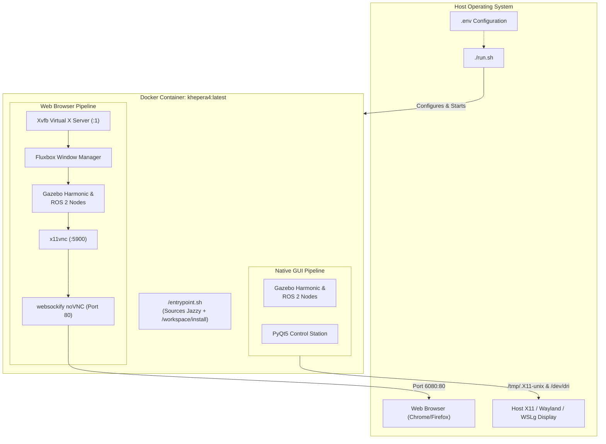

# Khepera IV Docker & Containerized Simulation Environment

Welcome to the Docker environment for the **BRT K4 Khepera IV ROS 2 Jazzy & Gazebo Harmonic** stack. This containerized setup provides a complete, turnkey simulation and control workstation without requiring ROS 2 Jazzy or Gazebo Harmonic to be installed directly on your host operating system.

---

## Table of Contents
1. [Architecture Overview](#1-architecture-overview)
2. [Prerequisites & Docker Installation](#2-prerequisites--docker-installation)
   - [Ubuntu 22.04 / 24.04 LTS (Recommended)](#21-ubuntu-2204--2404-lts-native-linux)
   - [Windows 11 (WSL2 + WSLg)](#22-windows-11-wsl2--wslg)
   - [macOS (Apple Silicon & Intel)](#23-macos-apple-silicon--intel)
   - [Post-Installation Steps](#24-post-installation-steps-linux--wsl2)
3. [Configuration & Environment Setup](#3-configuration--environment-setup)
4. [Building the Docker Container](#4-building-the-docker-container)
5. [Running the Simulation](#5-running-the-simulation)
   - [Mode 1: Native GUI Mode (`--native`)](#51-mode-1-native-gui-mode---native)
   - [Mode 2: Web Browser Mode (`--web`)](#52-mode-2-web-browser-mode---web)
6. [Executing ROS 2 Commands in the Container](#6-executing-ros-2-commands-in-the-container)
7. [Troubleshooting Guide](#7-troubleshooting-guide)

---

## 1. Architecture Overview

The container is built upon `osrf/ros:jazzy-desktop` on Ubuntu 24.04 (Noble Numbat) and packages:
* **ROS 2 Jazzy Jalisco**: Core robotics middleware, `ros_gz_bridge`, `rviz2`, and robot state publisher.
* **Gazebo Harmonic (GZ Sim 8)**: High-fidelity physics, sensor plugins (LiDAR, ultrasonic array, ground infrared, RGB camera).
* **Control & Telemetry Station**: PyQt5 graphical dashboard, Matplotlib real-time plotting, and teleoperation nodes.
* **Dual Display Pipeline**:
  - **Native Mode**: Direct X11 / Wayland / WSLg socket passthrough with hardware GPU acceleration (`/dev/dri`).
  - **Web Mode**: Self-contained Xvfb virtual framebuffer + Fluxbox window manager + x11vnc + websockify HTML5 noVNC server.



---

## 2. Prerequisites & Docker Installation

### 2.1 Ubuntu 22.04 / 24.04 LTS (Native Linux)

Follow the official Docker apt repository installation method to install Docker Engine and the Docker Compose v2 plugin:

```bash
# 1. Remove conflicting or legacy packages
for pkg in docker.io docker-doc docker-compose podman-docker containerd runc; do
    sudo apt-get remove -y $pkg 2>/dev/null || true
done

# 2. Set up Docker's official GPG key and APT repository
sudo apt-get update
sudo apt-get install -y ca-certificates curl gnupg
sudo install -m 0755 -d /etc/apt/keyrings
curl -fsSL https://download.docker.com/linux/ubuntu/gpg | sudo gpg --dearmor -o /etc/apt/keyrings/docker.gpg
sudo chmod a+r /etc/apt/keyrings/docker.gpg

echo \
  "deb [arch=$(dpkg --print-architecture) signed-by=/etc/apt/keyrings/docker.gpg] https://download.docker.com/linux/ubuntu \
  $(. /etc/os-release && echo "$VERSION_CODENAME") stable" | \
  sudo tee /etc/apt/sources.list.d/docker.list > /dev/null

# 3. Install Docker Engine, CLI, and Compose v2
sudo apt-get update
sudo apt-get install -y docker-ce docker-ce-cli containerd.io docker-buildx-plugin docker-compose-plugin
```

### 2.2 Windows 11 (WSL2 + WSLg)

Windows 11 supports native Linux GUI applications seamlessly through **WSLg**.

1. **Install WSL2 & Ubuntu 24.04:**
   Open PowerShell as Administrator:
   ```powershell
   wsl --install -d Ubuntu-24.04
   ```
   Restart your PC if prompted.

2. **Install Docker Desktop for Windows:**
   - Download the installer from [docker.com/products/docker-desktop](https://www.docker.com/products/docker-desktop/).
   - During installation, verify that **"Use the WSL 2 based engine"** is checked.
   - Open Docker Desktop, navigate to **Settings -> Resources -> WSL Integration**, and enable integration for your `Ubuntu-24.04` distro.

3. **Verify Inside WSL2 Terminal:**
   Open your Ubuntu terminal and test:
   ```bash
   docker compose version
   ```

### 2.3 macOS (Apple Silicon & Intel)

1. Download and install **Docker Desktop for Mac** from [docker.com/products/docker-desktop](https://www.docker.com/products/docker-desktop/).
2. In Docker Desktop Settings -> **General**, ensure **"Use Virtualization framework"** and **"Use Rosetta for x86/amd64 emulation"** (Apple Silicon) are enabled.
3. In Docker Desktop Settings -> **Resources**, allocate at least **4 CPU cores** and **6 GB RAM**.
4. **Recommended Mode for Mac:** Use **Web Browser Mode** (`./run.sh --web`). This avoids complex XQuartz setups and streams the desktop directly in your Mac browser.

### 2.4 Post-Installation Steps (Linux & WSL2)

To run Docker without prepending `sudo`:

```bash
# 1. Add current user to docker group
sudo usermod -aG docker $USER

# 2. Activate group changes immediately (or log out and back in)
newgrp docker

# 3. Verify Docker without sudo
docker run --rm hello-world
```
If you see `"Hello from Docker!"`, your installation is complete and properly permissioned.

---

## 3. Configuration & Environment Setup

The container configuration is managed via [`.env`](file:///home/andy/Desktop/khepera4_ws/.env). An annotated template is provided at [`.env.example`](file:///home/andy/Desktop/khepera4_ws/.env.example).

Create your `.env` file before first run:
```bash
cp .env.example .env
```

Key environment settings in [`.env`](file:///home/andy/Desktop/khepera4_ws/.env):

| Variable | Default | Description |
|---|---|---|
| `KHEPERA_DEFAULT_MODE` | `native` | Default mode for `./run.sh` (`native` or `web`). |
| `KHEPERA_WEB_PORT` | `6080` | Web port for noVNC browser interface (**NEVER use 1947**). |
| `COMPOSE_PROFILES` | `native` | Docker Compose profile (`native` or `web`). |
| `RESOLUTION` | `1920x1080x24` | Resolution for the virtual desktop in Web mode. |
| `ROS_DOMAIN_ID` | `0` | ROS 2 network domain (0-101) to isolate robot DDS traffic. |
| `LIBGL_ALWAYS_SOFTWARE` | `0` | Set to `1` to force CPU software rendering (Mesa llvmpipe). |

---

## 4. Building the Docker Container

The container image `khepera4:latest` is built from [Dockerfile](file:///home/andy/Desktop/khepera4_ws/docker/Dockerfile).

You can build the image using the turnkey launcher:
```bash
./run.sh --build
```

Alternatively, use standard Docker Compose:
```bash
docker compose --env-file .env -f docker/docker-compose.yml build
```

> [!NOTE]
> The initial build takes approximately 5–8 minutes as it downloads the base ROS 2 Jazzy image and installs Gazebo Harmonic, Qt5, and noVNC packages. Subsequent builds use cached layers and take only seconds.

---

## 5. Running the Simulation

The turnkey script [`run.sh`](file:///home/andy/Desktop/khepera4_ws/run.sh) in the workspace root handles display permissions, environment variables, and container lifecycles.

### 5.1 Mode 1: Native GUI Mode (`--native`)

Ideal for Linux workstations and Windows 11 WSLg with dedicated GPUs.

```bash
# Grant container access to local X11 display (Linux host)
xhost +local:root

# Launch native container shell
./run.sh --native
```

To directly launch the simulation in Native GUI mode:
```bash
# Single-robot simulation in Gazebo
./run.sh --native ros2 launch khepera4_description khepera4_sim.launch.py

# SLAM & sensor exploration stack
./run.sh --mapping

# 3-robot autonomous fleet station
./run.sh --multi
```

### 5.2 Mode 2: Web Browser Mode (`--web`)

Zero-configuration mode ideal for Macs, low-spec laptops, or lab computers. No X11 forwarding or host GUI configuration required!

```bash
./run.sh --web
```

Once launched:
1. Open your browser to: **[http://localhost:6080](http://localhost:6080)**
2. A full virtual Linux desktop will appear in your browser.
3. An interactive terminal is pre-opened with helper commands ready.
4. **Right-click on the desktop** anytime to access the Fluxbox application menu (Interactive Terminal, Launch Simulation, Control Station, RViz2, Keyboard Teleop).

To directly run a simulation command in Web mode:
```bash
./run.sh --web ros2 launch khepera4_description khepera4_sim.launch.py
```

---

## 6. Executing ROS 2 Commands in the Container

You can execute any ROS 2 command inside the container without entering an interactive bash prompt. Prepend `./run.sh --native` or `./run.sh --web`:

```bash
# Verify available ROS 2 packages
./run.sh --native ros2 pkg list | grep khepera

# Build the workspace inside the container
./run.sh --native colcon build --symlink-install

# Run package unit tests
./run.sh --native colcon test --packages-select khepera4_control

# List active ROS 2 topics
./run.sh --native ros2 topic list

# Echo robot odometry
./run.sh --native ros2 topic echo /khepera_1/odom
```

To open an interactive container bash shell:
```bash
./run.sh --native bash
```

Inside the container, the workspace is mounted at `/workspace`, and both ROS 2 Jazzy and `/workspace/install/setup.bash` are automatically sourced in `/root/.bashrc`.

---

## 7. Troubleshooting Guide

### 7.1 "Cannot connect to X server :0" / Display Authorization
**Cause:** Host X11 access control is rejecting connections from the Docker container.  
**Fix:** Run this command on your host before launching:
```bash
xhost +local:root
```
On Ubuntu Wayland, verify your display variable:
```bash
echo $DISPLAY
```
If your display is `:1` (common with modern Wayland compositors), Docker Compose automatically picks up your current `$DISPLAY`.

### 7.2 Port Conflict / Sentinel HASP Conflict (Port 1947)
> [!WARNING]
> **Strict Restriction on Port 1947:**  
> University engineering labs frequently run **Sentinel HASP / SafeNet License Manager** on port `1947` for CAD, MATLAB, and LabVIEW licenses. Binding port 1947 can disrupt campus license servers.  
> The Khepera IV stack defaults to **port 6080** and includes automated guards rejecting port 1947.

If port 6080 is already in use by another service on your machine:
```bash
# Check what is using port 6080
sudo lsof -i :6080

# Change the port in your .env file
echo "KHEPERA_WEB_PORT=6081" >> .env

# Launch simulation with new port
./run.sh --web
```
Now access the web interface at `http://localhost:6081`.

### 7.3 NVIDIA Hardware Acceleration vs Software Rendering
If you have an NVIDIA GPU on Linux, install the official NVIDIA Container Toolkit for maximum rendering performance:

```bash
# Install NVIDIA Container Toolkit
sudo apt-get install -y nvidia-container-toolkit
sudo nvidia-ctk runtime configure --runtime=docker
sudo systemctl restart docker
```

**If Gazebo crashes, displays a black screen, or reports OpenGL shader errors:**  
You can instantly switch to ultra-stable Mesa CPU software rendering (`llvmpipe`):

*Option 1:* Launch with inline environment override:
```bash
LIBGL_ALWAYS_SOFTWARE=1 ./run.sh --native ros2 launch khepera4_description khepera4_sim.launch.py
```

*Option 2:* Set it persistently in [`.env`](file:///home/andy/Desktop/khepera4_ws/.env):
```env
LIBGL_ALWAYS_SOFTWARE=1
```

### 7.4 File Permissions on Host Workspace
If files generated inside Docker (such as `build/` or `log/`) become owned by `root`, restore ownership to your host user:
```bash
sudo chown -R $USER:$USER /home/andy/Desktop/khepera4_ws
```

### 7.5 ROS 2 DDS Traffic Isolation (`ROS_DOMAIN_ID`)
If multiple students are working on the same university Wi-Fi or Ethernet subnet, ROS 2 nodes may discover each other's topics and cause interference.  
Assign each student a unique domain ID (from 1 to 101) in [`.env`](file:///home/andy/Desktop/khepera4_ws/.env):
```env
ROS_DOMAIN_ID=42
```

---

## 8. Summary of Quick Commands

```bash
# Step 1: Initial setup
cp .env.example .env

# Step 2: Build container
./run.sh --build

# Step 3: Run simulation (choose one)
./run.sh --native        # Native GUI (Linux / WSLg)
./run.sh --web           # Web Browser mode (noVNC at http://localhost:6080)
./run.sh --mapping       # SLAM & mapping demo
./run.sh --multi         # 3-robot autonomous fleet demo
```

For comprehensive architectural documentation, see [docs/docker_and_simulation.md](file:///home/andy/Desktop/khepera4_ws/docs/docker_and_simulation.md).
