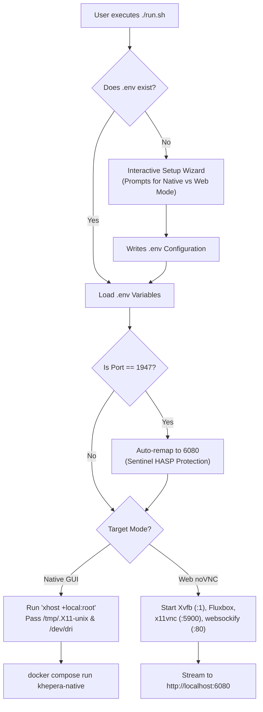

# Docker & Containerized Simulation Guide
**Project:** BRT K4 Khepera IV ROS 2 Stack  
**ROS Distro:** ROS 2 Jazzy Jalisco | **Simulator:** Gazebo Harmonic (GZ Sim 8)  
**Base Image:** Ubuntu 24.04 LTS (Noble Numbat) | **Container:** `khepera4:latest`

---

## 1. Prerequisites & Container Runtime Installation

This guide walks you through setting up Docker Engine and Docker Compose across Ubuntu, Windows 11 (WSL2), and macOS. The container provides a complete ROS 2 Jazzy and Gazebo Harmonic development station without altering your host system.

### 1.1 Linux Native (Ubuntu 22.04 / 24.04 LTS)

For Linux, **Docker Engine with Docker Compose v2** (via Docker's official apt repository) is strongly recommended over Docker Desktop or Snap packages.

```bash
# Step 1: Clean up any conflicting or obsolete distro packages
for pkg in docker.io docker-doc docker-compose podman-docker containerd runc; do
    sudo apt-get remove -y $pkg 2>/dev/null || true
done

# Step 2: Install prerequisite tools and add Docker's official GPG key
sudo apt-get update
sudo apt-get install -y ca-certificates curl gnupg
sudo install -m 0755 -d /etc/apt/keyrings
curl -fsSL https://download.docker.com/linux/ubuntu/gpg | sudo gpg --dearmor -o /etc/apt/keyrings/docker.gpg
sudo chmod a+r /etc/apt/keyrings/docker.gpg

# Step 3: Add Docker official repository to apt sources
echo \
  "deb [arch=$(dpkg --print-architecture) signed-by=/etc/apt/keyrings/docker.gpg] https://download.docker.com/linux/ubuntu \
  $(. /etc/os-release && echo "$VERSION_CODENAME") stable" | \
  sudo tee /etc/apt/sources.list.d/docker.list > /dev/null

# Step 4: Install Docker Engine, CLI, and Docker Compose v2 plugin
sudo apt-get update
sudo apt-get install -y docker-ce docker-ce-cli containerd.io docker-buildx-plugin docker-compose-plugin

# Step 5: Post-Installation - Enable Docker without sudo
sudo usermod -aG docker $USER

# Step 6: Apply group permissions immediately (or log out and back in)
newgrp docker
```

**Verify Linux Installation:**
```bash
docker --version
# Expected: Docker version 26.x or newer
docker compose version
# Expected: Docker Compose version v2.x.x
docker run --rm hello-world
# Expected: "Hello from Docker!"
```

---

### 1.2 Windows 11 (WSL2 + WSLg)

Windows 11 features **WSLg (Windows Subsystem for Linux GUI)**, which routes Wayland and X11 graphics straight to the Windows desktop with hardware acceleration.

1. **Install WSL2 and Ubuntu 24.04:**
   Open PowerShell as Administrator:
   ```powershell
   wsl --install -d Ubuntu-24.04
   ```
   Reboot your computer if prompted.

2. **Install Docker Desktop for Windows:**
   - Download the installer from the official portal: [Docker Desktop for Windows](https://www.docker.com/products/docker-desktop/).
   - During setup, confirm that **"Use the WSL 2 based engine"** is enabled.
   - Once installed, open Docker Desktop **Settings**:
     * **General:** Verify `Use the WSL 2 based engine` is checked.
     * **Resources -> WSL Integration:** Turn ON integration with your `Ubuntu-24.04` distribution.
     * Click **Apply & Restart**.

3. **Verify Inside WSL2:**
   Open your Ubuntu terminal and test:
   ```bash
   docker compose version
   docker run --rm hello-world
   ```

---

### 1.3 macOS (Apple Silicon M1/M2/M3/M4 & Intel)

macOS does not natively support X11 socket sharing (`/tmp/.X11-unix`). Therefore, **Web Browser Mode** (`./run.sh --web`) is the official, zero-friction choice for macOS users.

1. **Install Docker Desktop for Mac:**
   - Download from [Docker Desktop for Mac](https://www.docker.com/products/docker-desktop/) (select Apple Silicon or Intel depending on your Mac).
2. **Configure Settings for Simulation:**
   - Open Docker Desktop -> **Settings** -> **General**:
     * Enable **"Use Virtualization framework"**.
     * On Apple Silicon: Enable **"Use Rosetta for x86/amd64 emulation"**.
   - Navigate to **Resources**:
     * CPUs: Allocate at least **4 cores**.
     * Memory: Allocate at least **6 GB RAM** (8 GB recommended for Gazebo physics + RViz2).
     * Swap: 2 GB.
     * Virtual disk limit: 64 GB minimum.
3. **Execution on Mac:**
   Open Terminal in your cloned repository and run:
   ```bash
   ./run.sh --web
   ```
   Open Safari or Chrome to **[http://localhost:6080](http://localhost:6080)**.

---

## 2. Configuration & Environment Setup

The container reads its runtime variables from the [`.env`](file:///home/andy/Desktop/khepera4_ws/.env) file located in the workspace root.

Create your local `.env` from the provided template:
```bash
cp .env.example .env
```

### Key Configuration Parameters

```env
# Default execution mode: 'native' (Linux/WSLg) or 'web' (browser noVNC)
KHEPERA_DEFAULT_MODE=native

# Port for browser interface (DO NOT USE PORT 1947 - See Warning below)
KHEPERA_WEB_PORT=6080

# Active Compose profile ('native' or 'web')
COMPOSE_PROFILES=native

# Virtual desktop resolution for noVNC Web Mode
RESOLUTION=1920x1080x24

# ROS 2 Domain ID (0-101) for network isolation in shared university classrooms
ROS_DOMAIN_ID=0

# OpenGL Software Rendering Fallback (0 = Auto/GPU, 1 = Force Mesa llvmpipe)
LIBGL_ALWAYS_SOFTWARE=0
```

> [!WARNING]
> **Strict Port Restriction: NEVER bind to Port 1947.**  
> Port `1947` is globally registered to the **Sentinel HASP / SafeNet License Manager**, used universally in academic labs for MATLAB, SolidWorks, and LabVIEW network licenses. Binding port 1947 will disrupt university licensing services. The launcher script [`run.sh`](file:///home/andy/Desktop/khepera4_ws/run.sh) automatically blocks port 1947.

---

## 3. Building the Docker Image

The Docker image `khepera4:latest` is defined in [`docker/Dockerfile`](file:///home/andy/Desktop/khepera4_ws/docker/Dockerfile).

Build or rebuild the container using the universal launcher:
```bash
./run.sh --build
```

Or using Docker Compose directly:
```bash
docker compose --env-file .env -f docker/docker-compose.yml build
```

> [!TIP]
> The initial build downloads base layers and compiles packages (~5 to 8 minutes depending on network bandwidth). All subsequent builds use Docker cache layers and finish within seconds.

---

## 4. Universal Interactive Launcher (`run.sh`)

The repository includes a battle-tested bash launcher [`run.sh`](file:///home/andy/Desktop/khepera4_ws/run.sh) in the workspace root. It handles environment loading, X11 security tokens, display routing, container cleanup, and process teardown.



### 4.1 First-Time Setup Wizard
If you execute `./run.sh` without arguments and no `.env` file exists, it guides you interactively:
```text
==================================================================
  BRT K4: Khepera IV ROS 2 Jazzy & Gazebo Harmonic Simulation
==================================================================
Select default simulation mode:
 1) Capable PC - Native GUI (WSLg / GPU pass-through)
 2) Web Browser - Quick demo (noVNC on http://localhost:6080)
Enter choice [1 or 2] (default: 1): 
```
Your selection is written to `.env` and remembered for subsequent runs. To change it later, run `./run.sh --config`.

### 4.2 CLI Flag Reference

| Flag | Purpose | Target Action |
|---|---|---|
| `./run.sh` | Launch default mode configured in `.env` | Active profile in `.env` |
| `./run.sh --native` | Force Native GUI mode (Linux X11/Wayland or Windows WSLg) | High-performance host windowing |
| `./run.sh --web` | Force Web Browser mode (noVNC HTML5 virtual desktop) | Browser access at `http://localhost:6080` |
| `./run.sh --mapping` | Launch autonomous exploration & persistent SLAM mapping | `mapping.launch.py` with dashboard |
| `./run.sh --multi` | Launch 3-robot collaborative fleet in Gazebo | `multi_robot_station.launch.py` |
| `./run.sh --build` | Rebuild the Docker image `khepera4:latest` | `docker compose build` |
| `./run.sh --config` | Re-run interactive setup wizard and update `.env` | Rewrite `.env` |
| `./run.sh --help` | Print syntax, options, and usage examples | Help banner |
| `./run.sh [MODE] [CMD]` | Execute an arbitrary ROS 2 command inside the container | Container shell execution |

---

## 5. Simulation Modes Deep-Dive

| Feature | `khepera-native` (Native GUI) | `khepera-web` (Web Browser) |
|---|---|---|
| **Best Suited For** | Linux desktops/laptops, Windows 11 with WSLg | macOS, low-power laptops, student presentations |
| **Window System** | Host X11 / Wayland / WSLg compositors | In-container virtual Xvfb display server (`:1`) |
| **Display Passthrough** | Mounted `/tmp/.X11-unix` and `/dev/dri` | WebSocket HTML5 stream over port 6080 |
| **Window Manager** | Host Desktop (GNOME, KDE, Cosmic, Windows) | Ultra-lightweight Fluxbox with custom menu |
| **GPU Acceleration** | Full hardware GPU (NVIDIA / AMD / Intel / WSLg) | Mesa llvmpipe software rendering or host vGPU |
| **Networking** | `network_mode: "host"` (Native DDS discovery) | Port mapping `${KHEPERA_WEB_PORT:-6080}:80` |
| **Host Configuration** | Requires `xhost +local:root` on Linux | Zero host configuration required |

### 5.1 Native GUI Mode Details
Native mode mounts the host X11 socket and GPU rendering devices directly:
* Sockets: `/tmp/.X11-unix:/tmp/.X11-unix:rw`
* Direct Rendering: `/dev/dri:/dev/dri` (Intel/AMD/WSLg hardware acceleration)
* IPC: `ipc: host` for zero-copy shared memory rendering between ROS 2 nodes and GUI applications.

To run:
```bash
xhost +local:root
./run.sh --native
```

### 5.2 Web Browser Mode Details
In Web mode, [`docker/start-web.sh`](file:///home/andy/Desktop/khepera4_ws/docker/start-web.sh) initializes a complete virtual desktop:
1. **Xvfb**: Virtual X11 framebuffer operating on display `:1` at specified resolution (default `1920x1080x24`).
2. **Fluxbox**: Window manager equipped with a custom right-click menu tailored for Khepera IV.
3. **x11vnc**: High-performance VNC server bound to loopback `127.0.0.1:5900`.
4. **websockify + noVNC**: HTML5 WebSocket gateway serving the desktop over HTTP on port `80` (mapped to host port `6080`).

**Access URLs:**
* Main Web Portal: **[http://localhost:6080](http://localhost:6080)**
* Direct Fullscreen View: **[http://localhost:6080/vnc.html?autoconnect=true&resize=remote](http://localhost:6080/vnc.html?autoconnect=true&resize=remote)**

**Fluxbox Right-Click Menu:**
Right-click anywhere on the browser desktop to instantly launch:
- Interactive Terminal (`xterm`)
- Launch Gazebo Simulation (`khepera4_sim.launch.py`)
- Launch Control Station GUI (`control_station.launch.py`)
- Launch RViz2 (`rviz2`)
- Keyboard Teleoperation (`teleop_twist_keyboard`)

---

## 6. Running Specific ROS 2 Commands Inside Docker

You do not need to maintain an interactive container shell to run builds, tests, or launch files. You can pass commands directly to [`run.sh`](file:///home/andy/Desktop/khepera4_ws/run.sh):

```bash
# 1. Verify installed ROS 2 packages
./run.sh --native ros2 pkg list | grep khepera

# 2. Build workspace inside the container
./run.sh --native colcon build --symlink-install

# 3. Run control stack unit tests
./run.sh --native colcon test --packages-select khepera4_control

# 4. View test results summary
./run.sh --native colcon test-result --all

# 5. Launch custom Gazebo simulation headless
./run.sh --native ros2 launch khepera4_description khepera4_sim.launch.py headless:=true

# 6. Launch ROS 2 teleoperation console
./run.sh --native ros2 run teleop_twist_keyboard teleop_twist_keyboard

# 7. Check active topic graph
./run.sh --native ros2 topic list
```

---

## 7. Troubleshooting Guide

### 7.1 Display Permissions: "Cannot connect to X server :0"
* **Symptom:** Running `./run.sh --native` produces an error: `Authorization required, but no authorization protocol specified` or `Cannot connect to X server :0`.
* **Remedy:** On your Linux host, grant the container permission to communicate with your X11 session:
  ```bash
  xhost +local:root
  ```
* **Wayland Compositors:** On modern Ubuntu 24.04 systems running Wayland (or Cosmic), confirm your active display:
  ```bash
  echo $DISPLAY
  ```
  If your display is `:1`, Docker Compose automatically picks up `${DISPLAY:-:0}` from your host environment.

---

### 7.2 Port Conflicts & Port 1947 Restriction
* **Symptom:** Web mode fails to start with `bind: address already in use` or crashes on port 6080.
* **Diagnosis:**
  ```bash
  sudo lsof -i :6080
  # or
  netstat -tuln | grep 6080
  ```
* **Remedy:** Assign a different port (such as 6081 or 8080) in your [`.env`](file:///home/andy/Desktop/khepera4_ws/.env):
  ```env
  KHEPERA_WEB_PORT=6081
  ```
* **Academic Safety Notice:** Never configure `KHEPERA_WEB_PORT=1947`. Port 1947 is globally used by Sentinel HASP license managers in engineering labs. The launcher script includes hard safeguards preventing port 1947 from ever being bound.

---

### 7.3 Graphics Hardware Acceleration vs Software Rendering

#### NVIDIA Container Toolkit Setup (Linux Host)
To enable direct GPU acceleration for NVIDIA graphics cards:
```bash
# 1. Install NVIDIA container toolkit
sudo apt-get install -y nvidia-container-toolkit

# 2. Configure Docker daemon
sudo nvidia-ctk runtime configure --runtime=docker

# 3. Restart Docker service
sudo systemctl restart docker
```

#### Software Rendering Fallback (`LIBGL_ALWAYS_SOFTWARE=1`)
If your graphics driver has shader compiler incompatibilities, or if Gazebo Harmonic crashes with an OpenGL context error:
Force Mesa to use CPU-based software rasterization (`llvmpipe`):

**Option A (Temporary command):**
```bash
LIBGL_ALWAYS_SOFTWARE=1 ./run.sh --native ros2 launch khepera4_description khepera4_sim.launch.py
```

**Option B (Persistent in `.env`):**
Edit [`.env`](file:///home/andy/Desktop/khepera4_ws/.env):
```env
LIBGL_ALWAYS_SOFTWARE=1
```
This forces pure Mesa software rendering and bypasses buggy GPU drivers completely.

---

### 7.4 File Permissions on Host Workspace
Because containers frequently run as `root`, files generated inside the container (e.g. `build/`, `install/`, `log/`) may be created with root ownership, preventing editing on the host.

To restore ownership to your host user:
```bash
sudo chown -R $USER:$USER /home/andy/Desktop/khepera4_ws
```

---

### 7.5 ROS 2 DDS Traffic Isolation (`ROS_DOMAIN_ID`)
If multiple students are operating simulation stacks on the same university Wi-Fi or laboratory LAN:
ROS 2 uses DDS multicast discovery by default. If two students share `ROS_DOMAIN_ID=0`, their robots will cross-talk and interfere with each other's topics.

**Remedy:** Assign every student a distinct domain ID in [`.env`](file:///home/andy/Desktop/khepera4_ws/.env):
```env
# Student 1:
ROS_DOMAIN_ID=10

# Student 2:
ROS_DOMAIN_ID=20
```
Valid values range from `0` to `101`.

---

## 8. VS Code Dev Containers Integration

The workspace includes a turnkey Dev Container configuration in [`.devcontainer/devcontainer.json`](file:///home/andy/Desktop/khepera4_ws/.devcontainer/devcontainer.json).

1. Install Visual Studio Code on your host machine.
2. Install the **Dev Containers** extension (`ms-vscode-remote.remote-containers`).
3. Open the `khepera4_ws` folder in VS Code.
4. When prompted (or via `F1 -> Dev Containers: Reopen in Container`), click **Reopen in Container**.
5. VS Code will automatically connect inside `khepera4:latest` with Python, C++, ROS 2, and URDF language servers preconfigured.
